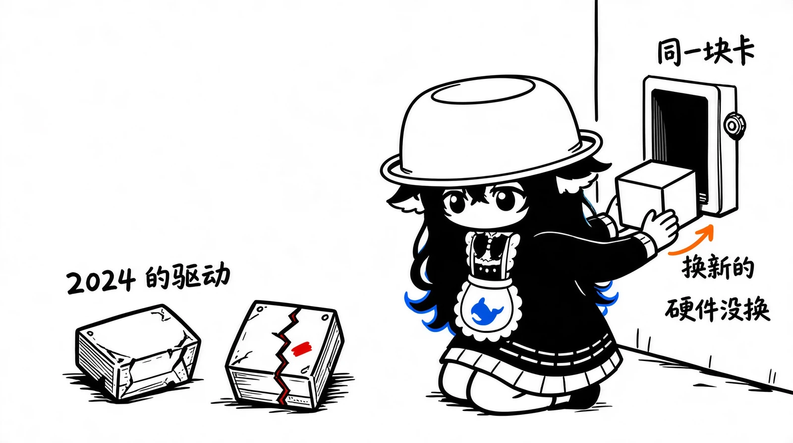

# Wi-Fi 一直连着，网却突然没了

笔记本的 Wi-Fi 用着用着突然就上不了网，右下角图标一直显示连着。把 Wi-Fi 断开再连上，能恢复一会儿，过一阵又没网。感觉像网卡被什么东西踢掉了。

机器是华硕天选 4（R9），网卡 Realtek 8852BE，系统 Windows 11 build 26300。买之前就听人说过天选系列掉网卡，这次症状一出来，我第一反应是终于轮到我了。

那段时间连的热点叫 oppo A5，是热点名，和手机型号没关系。

## 先看日志

事件查看器里 WLAN 的记录在 `应用程序和服务日志 → Microsoft → Windows → WLAN-AutoConfig → Operational`，用 PowerShell 拉更省事：

```powershell
Get-WinEvent -LogName 'Microsoft-Windows-WLAN-AutoConfig/Operational' -MaxEvents 40 |
  Select-Object TimeCreated, Id, LevelDisplayName, Message
```

记录里能看到一段密集的断开和重连：

```
23:57:28 连接
23:59:54 断开
23:59:57 连接
00:02:26 断开
00:02:29 连接
00:04:51 断开
```

间隔两三分钟。现在回头看，这些应该是我反复手动断连留下的痕迹，当时一发现没网就这么操作一次。

断开事件的 ID 是 8003，原因一栏写着「由于该接口上的操作状态更改请求，网络已断开连接」。这个原因码和信号强弱、密码都没有关系，是连接被主动断开的记录。

再看 IP，当时 WLAN 拿到的是 `169.254.178.146`。


## 169.254 是什么

169.254 开头的地址是 Windows 在 DHCP 失败后自己编的，叫 APIPA。看到这个地址基本可以确定：链路连上了，认证也过了，但没有拿到 IP。

系统日志里还有一条 4003 警告：

```
WLAN AutoConfig detected limited connectivity, attempting automatic recovery
```

所以状态栏显示连着，但这个连接拿不到地址，网页自然打不开。偶尔重连之后 DHCP 成功了，就恢复正常，直到下一次再断。

传说中的掉网卡不是这个样子。网卡一直在工作，只是拿不到地址。

另外还有一条 NDIS 10317 的错误，说 Wi-Fi Direct 虚拟适配器电源切换失败：

```
Miniport Microsoft Wi-Fi Direct Virtual Adapter #2 ... had event Fatal error:
The miniport has failed a power transition to operational power
```

这条只出现一次，可能和 Modern Standby 有关，但规模对不上，先放一边。

## 驱动版本

```powershell
Get-NetAdapter -Name WLAN | Select Name, DriverVersion, DriverDate
```

结果是 `6001.15.155.1`，日期 2024-10-25。

2026 年的系统配 2024 年的无线驱动。8852BE 这颗芯片掉线的反馈一直不少，我决定从这里下手。

Windows Update 里没有它的驱动。用 COM 接口查了一遍驱动类更新，只推了个触控板的。于是去微软的更新目录（catalog.update.microsoft.com）搜 8852BE，按日期排下来最新的两个：

- 6001.15.165.3，2026-07-12
- 6101.19.138.1，2026-06-24

现有的驱动在 6001 系列，选了 165.3，2.4 MB 的 cab。

## 装之前先对硬件 ID

解压之后翻了 INF。Realtek 这份 INF 把各家厂商的子型号都列了出来，其中一行是：

```
%RTL8852be.DeviceDesc% = ASUS8852be.ndi, PCI\VEN_10EC&DEV_B852&SUBSYS_54711A3B ;;Azurewave
```

`54711A3B` 和我设备管理器里的 subsystem 一致。签名也查了，sys 是 Realtek 的代码签名，cat 是微软 WHQL，状态都是 Valid。



## 安装

```powershell
pnputil /add-driver .\netrtwlane601.inf /install
```

装完提示需要重启。重启后连上热点，目前没再断过。

## 顺手改的省电设置

在注册表里把网卡的电源管理关了：

```powershell
reg add "HKLM\SYSTEM\CurrentControlSet\Control\Class\{4d36e972-e325-11ce-bfc1-08002be10318}\0001" /v PnPCapabilities /t REG_DWORD /d 24 /f
```

对应设备管理器里那个「允许计算机关闭此设备以节约电源」。不确定这一步有没有用，反正成本很低。

## 两个 Git Bash 的坑

排查过程中被 Windows 和 Git Bash 的差异绊了两次，记一下。

Git Bash 里的 `expand` 是 GNU coreutils 的那个，不认 Windows 的 `-F:*` 参数，得写全路径：

```bash
/c/Windows/System32/expand.exe -F:* driver.cab ./out
```

`shutdown /r /t 30` 也跑不通，`/r` 被 MSYS 的路径转换当成了文件路径，最后报参数错误。要么加环境变量，要么换成连字符：

```bash
MSYS_NO_PATHCONV=1 shutdown.exe -r -t 30
```

## 如果你也用 8852BE

先看驱动版本。低于 6001.15.165.3 的话，可以从微软更新目录取新的，没必要去第三方驱动站。

换了之后还断，可以再看看热点的加密方式。我连的这个是 WPA3-Personal，8852BE 对 WPA3 的兼容性口碑一般，改成 WPA2 也许能缓解。这次换完驱动就没再复现，这一步我没测到。