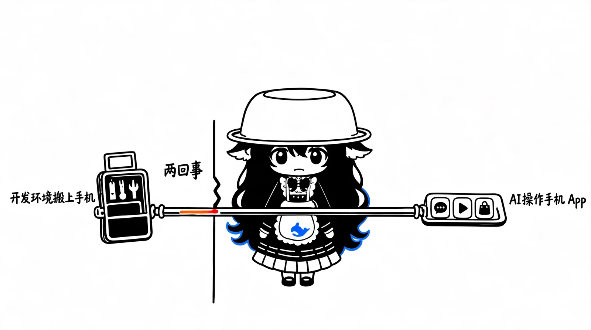

# DSH Go 与 Mika 对比：两种手机 AI Agent 的不同定位

我调研的是这两个 GitHub 项目：

- DSH Go：[ccch1mneyyy/dsh-Go](https://github.com/ccch1mneyyy/dsh-Go)
- Mika：[wangzan101/Mika](https://github.com/wangzan101/Mika)

调研基准是 2026 年 11 月 6 日，以两者当前的 README、官方文档和 Release 为准。

先说我的判断：这两个项目有功能重叠，但本质上不是同一种产品。

DSH Go 是把 AI Agent 开发环境带到手机上；Mika 则是让 AI 真正学会操作手机上的各种 App。



# 一、核心定位

DSH Go 是移动端 Agent 工作环境。本质上是 DeepSeek Harness 的 Android 客户端，可以在手机本地运行 DSH，也可以远程连接电脑上的 DSH。重点是开发、工具调用、代码任务和远程会话。

Mika 是手机自动化 Agent。它可以在手机后台打开 App、读取内容、点击、输入、滚动，甚至完成跨 App 的任务。重点是自动化、信息处理和日常事务。

举个例子：


| 你想做的事情 | 更适合 |
| --------------------------- | ------ |
| 在手机上继续电脑中的 AI 编程任务 | DSH Go |
| 远程连接家中电脑上的 DSH | DSH Go |
| 让 AI 帮你操作微信 | Mika |
| 自动浏览小红书并整理内容 | Mika |
| 自动发送消息、填写表单 | Mika |
| 让 Codex / Claude 从电脑向手机派发任务 | Mika |
| 在手机本地运行完整的 DSH Agent | DSH Go |


# 二、功能详细对比

这是两者最值得关注的部分。

## 1. 手机操控能力

DSH Go 可以让 DSH 读取手机屏幕、点击和输入。它的特点是：

- 通过 Android 无障碍服务实现手机操控。
- 可以在执行过程中暂停、停止和插话。
- 对进入新 App、发送、删除、付款等操作提供确认机制。
- 银行、证券类 App 默认设置为不操作，微信默认每一步确认。

明显缺点：

- 必须使用手机本地运行的 DSH 引擎，远程连接电脑上的 DSH 时不能用这套手机操控能力。
- 操作过程中需要保持屏幕亮起、手机解锁。
- 熄屏会停止任务。
- 连续 3 分钟没有新操作会自动结束任务。
- 不打扰模式需要 Android 14+，并额外配置 Shizuku 或自连接 ADB。

来源：[DSH Go 手机操控指南](https://github.com/ccch1mneyyy/dsh-Go/blob/main/docs/guide/zh/04-phone-control.md)。

Mika 最有意思的设计是，它可以在独立的后台屏幕中操作 App，而你继续使用自己的手机。比如你让它：

- 打开微信，读取今天的群聊并总结。
- 打开 B 站，整理某个 UP 主最近的视频。
- 打开小红书，搜索、浏览并筛选内容。
- 打开招聘网站，搜索岗位并打招呼。
- 打开购物软件，筛选商品并加入购物车。

它不需要每个 App 都开发专门的接口，而是像人一样观察界面，识别按钮、点击和输入。还支持同时运行多个后台任务，同一个 App 被多个任务同时使用时，会进行任务协调。

明显缺点：

- 依赖界面识别和模拟操作，页面布局改变、异常弹窗、验证码等可能影响执行。
- 部分密码和付款界面禁止截图，需要人工接管。
- 操作其他 App 需要 Android 12+，推荐 Android 14+。
- 首次配置需要开启开发者选项、USB 调试、无线调试并完成配对。

来源：[Mika 功能说明](https://github.com/wangzan101/Mika/blob/main/docs/features.en.md)、[手机操控配置指南](https://github.com/wangzan101/Mika/blob/main/docs/setup-guide.en.md)。

这一项 Mika 更强。特别是后台虚拟屏幕的设计，实际使用价值很高。它不是简单地帮你点击当前屏幕，而是尽量把 AI 的操作和人的正常使用隔离开。

## 2. AI 能力和模型支持

这里要特别注意：两个软件都不是模型本身，而是 Agent 运行环境。


| 对比 | DSH Go | Mika |
| ------------------ | ---------------- | ------------------------------- |
| 核心引擎 | DeepSeek Harness | Mika 自己的 Agent 框架 |
| 模型来源 | 自行配置的模型提供方 | 多模型、多提供方 |
| DeepSeek | 支持 | 支持 |
| Qwen | 取决于 DSH 提供方配置 | 预置支持 |
| Kimi | 取决于 DSH 提供方配置 | 预置支持 |
| OpenAI | 取决于 DSH 提供方配置 | 预置支持 |
| Anthropic | 取决于 DSH 提供方配置 | 预置支持 |
| Ollama / LM Studio | 取决于 DSH 配置 | 预置支持 |
| 账户登录 | 依赖 DSH 对应配置 | 支持 ChatGPT、xAI、OpenRouter 等账户登录 |


Mika 的模型兼容性做得比较全面。官方列出了 DeepSeek、通义千问、Kimi、智谱、MiniMax、OpenRouter、Anthropic、Gemini、OpenAI、xAI、Mistral、Groq、Ollama、LM Studio 等提供方。还有一个很实用的特点：可以使用 ChatGPT Plus / Pro 等账户登录，而不一定非要配置 API Key。具体账户接入规则以项目文档为准。

来源：[Mika README](https://github.com/wangzan101/Mika)。

我的评价是：Mika 在模型接入方面更方便，DSH Go 的优势则是直接使用 DSH 的 Agent 体系和工具生态。

## 3. 电脑与手机之间的协作

这一项我认为特别值得展开。

**DSH Go：远程连接电脑上的 DSH。** 它提供两种主要远程连接方式：

- SSH：直接连接自己的电脑或服务器。
- DSH Remote：通过远程插件建立加密连接，不需要自己配置公网网络。

比如你在家里的 Windows 电脑启动 DSH，手机通过 DSH Go 连接过去，就可以查看和继续电脑上的 DSH 会话。

但注意，它不是通用的电脑远程控制软件，电脑上必须运行 DSH。

远程模式还有一些限制：目前只支持图片附件，不能在 App 内打开网页版，插件只能开关，也不支持 DS Bot 和对话日志导出。

来源：[DSH Go 主机连接指南](https://github.com/ccch1mneyyy/dsh-Go/blob/main/docs/guide/zh/03-engine-hosts.md)。

**Mika：电脑上的 AI 可以直接向手机派发任务。** 这部分甚至有点超出我对它最初的预期。

Mika 不只是一个独立运行的 Android 软件，它还提供 CLI、Skill 和 MCP Server，让电脑上的 AI Agent 可以向手机上的 Mika 派发任务，读取进度、回答追问并获取结果。

```text
Codex / Claude
      |
      | MCP / CLI / Skill
      v
    Mika
      |
      v
 Android 手机
      |
      +-- 微信
      +-- B站
      +-- 小红书
      +-- 浏览器
      +-- 其他 App
```

这意味着你可以在电脑上对 AI 说：

「帮我打开手机微信，找到某个人今天发的消息，然后总结给我。」

电脑上的 Agent 不需要自己模拟手机操作，而是把任务交给 Mika。

官方文档：[Use Mika from a computer](https://github.com/wangzan101/Mika/blob/main/docs/computer.en.md)。

这一项 Mika 更有扩展价值，尤其是它提供了 MCP 接口，不局限于作者自己的聊天界面。

## 4. 定时任务和记忆能力


| 功能 | DSH Go | Mika |
| -------- | ------------------- | ---------------- |
| 定时任务 | 支持 | 支持 |
| 条件触发 | 取决于 DSH 任务能力 | 支持 |
| 用户偏好记忆 | 依赖 DSH 配置与机制 | 内置 |
| 自动积累操作经验 | 依赖 Skills / Plugins | 可将任务经验整理为 Skills |
| 任务中途插话 | 支持 | 支持 |
| 多任务并行 | 取决于 DSH 主机 | 支持后台任务协调 |
| 任务过程记录 | 支持 | 支持逐步查看 |


Mika 的记忆和 Skill 机制比较有意思。比如你告诉它：

「我习惯把重要消息整理成 Markdown，不要直接发出去。」

它可以记住你明确告知的偏好。完成任务后，还可以将一些经你认可的操作经验整理成技能，供以后复用。

不过要注意，Mika 默认的 Ask 模式并不是每一步都问你：

- 付款、下单等花钱操作需要确认。
- 发消息、提交表单、删除内容、修改系统设置等默认直接执行。
- Autonomous 模式则连付款确认都可以取消。

因此，不能仅因为它叫 Ask 模式就认为它会对所有有影响的操作进行确认。

来源：[Mika Ask / Autonomous 说明](https://github.com/wangzan101/Mika/blob/main/docs/modes.en.md) 和 [Mika 功能说明](https://github.com/wangzan101/Mika/blob/main/docs/features.en.md)。

# 三、项目本身的优缺点

这部分从开源项目和长期使用角度来看。


| 维度 | DSH Go | Mika |
| ------------- | ---------------------- | --------------------------------- |
| 开发语言 | Dart / Flutter | Kotlin |
| 核心架构 | DSH + PRoot Linux 环境 | 原生 Android Agent |
| 最低 Android 版本 | Android 8 | Android 11（聊天）；Android 12（操控 App） |
| 手机本地运行环境 | Ubuntu + Node.js + DSH | Agent 本身 + 按需 Linux 沙箱 |
| Root | 不需要 | 不需要 |
| 操控配置 | 无障碍服务 | 无线调试 / ADB 配对 |
| 远程电脑 | SSH / DSH Remote | CLI / MCP / Skill 派发任务 |
| 许可证 | AGPL-3.0 | Apache-2.0 |


## DSH Go 的优点

1. 完整的 DSH 生态：不只是聊天界面，还有工具、插件、工作区和引擎。
2. 本机与远程自由切换：手机可以作为独立运行环境，也可以作为电脑 DSH 的移动客户端。
3. 移动端体验做得比较细：原生界面、网页版、对话回放、语音、桌宠、平板适配等。
4. 对操作的确认机制更细致：可以按任务、按应用调整确认策略。

## DSH Go 的缺点

1. 手机本机运行需要额外的 Linux 环境，官方建议预留约 1GB 空间。
2. 本机引擎的资源消耗比单纯的聊天客户端大。
3. 手机操控不适合熄屏运行。
4. 远程模式有功能限制，不能直接把所有本机能力带过去。
5. AGPL-3.0 对二次分发和修改后提供网络服务有许可证义务。
6. 最新版本存在值得注意的升级风险，后面单独说明。

## Mika 的优点

1. 手机自动化能力更突出，无需针对每个 App 写专用插件。
2. 后台虚拟屏幕非常实用，不影响你正常使用手机。
3. 支持定时任务、任务中途插话、记忆和 Skills。
4. 提供 MCP、CLI、Skill，方便电脑上的其他 AI 调用。
5. 模型提供方选择非常丰富。
6. Apache-2.0，二次开发和集成相对宽松。

## Mika 的缺点

1. 手机控制需要额外开启无线调试，初次配置比普通 APK 麻烦。
2. Android 14+ 才是推荐的完整体验环境。
3. UI 自动化依赖界面识别，不能保证每个 App、每次操作都成功。
4. 密码、验证码和支付等敏感操作必须人工接管。
5. 对一些第三方 App 的自动化操作可能违反其服务条款。
6. 目前仍是 0.x 版本，不能把它当作完全成熟的系统自动化平台。

# 四、隐私、安全与费用

这部分不能忽略，因为两者都能接触手机上的敏感信息。


| 项目 | DSH Go | Mika |
| ------------ | ------------- | ----------------- |
| 是否需要自己的模型提供方 | 是 | 是 |
| 是否完全离线 | 否 | 否 |
| 屏幕内容是否可能发给模型 | 是 | 是 |
| 是否有官方服务器依赖 | 分享等功能涉及服务 | 官方声称没有 Mika 自有服务器 |
| 数据保存 | 按本机、远程主机和功能而定 | 对话、任务记录保存在本机 |
| 默认使用统计 | 匿名统计默认开启 | 更新检查联系 GitHub |
| 开源许可证 | AGPL-3.0 | Apache-2.0 |


DSH Go 开启手机操控后，屏幕文字可能发送给模型提供商，视觉模型还可能收到截图。它会对部分敏感数字进行打码，但这不等于能够保证所有敏感内容都不会泄漏。匿名使用统计默认开启，可以在隐私设置中关闭。

Mika 官方表示没有自己的 Mika 服务器，API Key、记忆加密存储在手机本地，对话和任务记录也留在本机。但你使用的模型提供商仍然会收到模型请求和任务所需的信息。另外，Mika 的手机操控需要配置 ADB 无线调试，这意味着你需要认真考虑授予其手机助手的权限。不要随便开放不必要的 Root 能力。

来源：[DSH Go 安全与隐私说明](https://github.com/ccch1mneyyy/dsh-Go)、[Mika 隐私说明](https://github.com/wangzan101/Mika)。

费用方面，两者软件本身都是开源免费的，但模型 API、账户订阅和远程服务器等费用由你使用的服务决定。

# 五、当前版本和项目活跃度

截至 2026 年 11 月 6 日：

**DSH Go** 最新 Release 是 1.0.11，2026-11-05 发布，GitHub 约 11.8k Stars。这一版本升级了内置 DSH 引擎至 0.2.2-rc.1，也修复了多项手机操控、远程连接问题。

升级注意事项：官方明确说明，这次引擎升级尚未在真实手机上验证，只在 x86_64 模拟器上进行了测试。另外，升级会清理 Linux 环境中部分已自行安装的软件和文件，不建议直接把它当成无风险更新。

[查看 DSH Go Releases](https://github.com/ccch1mneyyy/dsh-Go/releases)

**Mika** 最新 Release 是 0.1.37，2026-11-05 发布，GitHub 约 7.2k Stars。最新版本修复了任务执行、模型统计、虚拟屏幕和连接问题，还增加了 Root 手机启动助手的可选方式。

[查看 Mika Releases](https://github.com/wangzan101/Mika/releases)

我的判断是：两个项目都处在快速迭代阶段。DSH Go 虽然已经进入 1.0，但底层引擎仍有 RC 版本；Mika 则仍处于 0.x。Stars 数量不能代表实际可靠性。

# 六、到底应该选哪个

我按照实际用途给出选择。

## 场景 A：想让 AI 成为手机助理

优先 Mika。

如果你想让 AI 帮你操作微信、QQ、小红书、B 站、浏览器，处理信息和执行日常任务，我会优先推荐它。它的后台操作机制，以及 MCP 接口是最值得尝试的地方。

## 场景 B：想把 AI 编程环境带在身上

优先 DSH Go。

如果你已经在使用 DSH，想通过手机继续电脑上的开发工作，或者直接在手机上跑 DSH，那么选它。但不要把它理解为 Codex、Claude Desktop 的通用手机遥控端。

## 场景 C：想让电脑上的 AI 直接控制手机

优先 Mika，更合适。

它提供 MCP / CLI / Skill，适合把手机变成电脑 Agent 的一个执行终端。

# 七、我认为最值得考虑的组合

其实没有必要强行二选一。

```text
Windows 电脑
Codex
Claude
其他 Agent
     |
     | MCP / CLI / Skill
     v
   Mika
   手机自动化执行层
微信 / B站 / 浏览器 / 小红书
     |
DSH Go
DSH 的移动端工作环境和远程入口
手机本地 DSH / 远程电脑 DSH
```

这里需要强调：这是架构上的组合设想，不代表 Mika 与 DSH Go 已经有官方直接集成。它们可以分别承担不同职责。

结合你之前的 Codex Desktop + Claude Desktop 协作需求，Mika 的 MCP 接口尤其值得研究：它可以让电脑上的 Agent 调用手机上的任务能力，而不只是给手机再装一个聊天客户端。

# 八、我的最终评价


| 评价维度 | 更值得选 |
| ------------ | ------ |
| 手机 App 自动化 | Mika |
| 后台执行、不影响正常使用 | Mika |
| MCP 对接其他 AI | Mika |
| 多模型接入便捷度 | Mika |
| 手机本机运行 DSH | DSH Go |
| 远程操作电脑 DSH | DSH Go |
| DSH 插件生态 | DSH Go |
| 开源二次开发友好度 | Mika |
| 手机操控确认策略细致程度 | DSH Go |


我更建议你优先实际体验 Mika。不是因为它的 Stars 少或多，而是它的核心能力比较特别：它让 Android 手机成为了一个能够被电脑 Agent 调用的自动化执行环境。

而 DSH Go 更像一个完整的移动端 DSH 工作站。如果你本身没有特别强的 DSH 使用需求，它的部分优势可能发挥不出来。

最值得进一步研究的是 Mika 的 MCP 实现，我觉得这部分甚至比它本身的手机聊天界面更有长期价值。