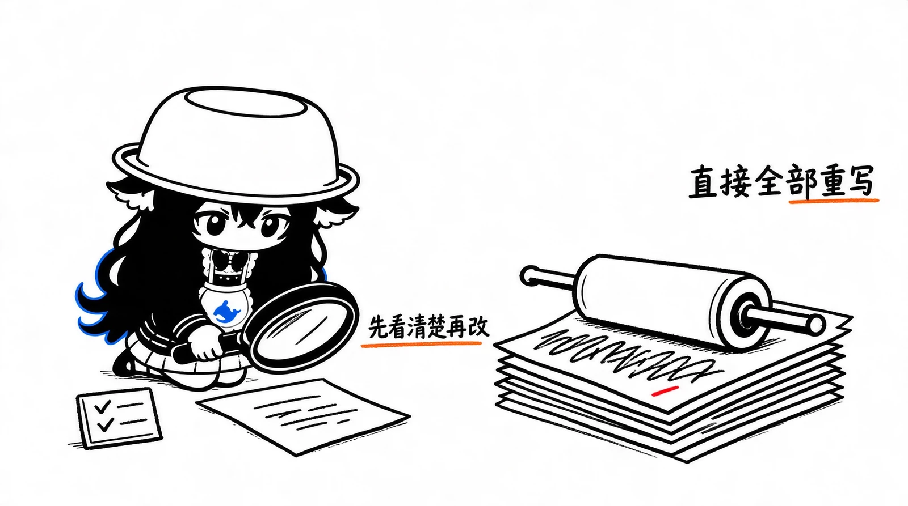

# Lieflat Less AI Tone vs Humanizer：两种去 AI 味思路的对比

先说一个关键区别：Lieflat Less AI Tone 的核心是「用实测证据找出 AI 写作特征，再有针对性地修改」；而 Humanizer 这类工具通常更偏向「按照人类写作习惯直接重写文本」。

这两种思路看起来都是去 AI 味，但实际解决的问题并不完全一样。

## 1. Lieflat Less AI Tone

仓库：[larashero3-dotcom/lieflat-less-ai-tone](https://github.com/larashero3-dotcom/lieflat-less-ai-tone)

中文写作导向，Agent Skill + Python 检测脚本 + 研究型规则库。

它比较有意思的地方在于：作者没有直接罗列一份「AI 禁用词清单」，而是做了两轮对照实验。

- 第一轮：629 篇文章，其中 300 篇 AI 生成、329 篇人类创作。
- 第二轮：270 组同主题、同事实材料的配对文章。
- 累计约 520 万汉字，约 50 万次模型语义判断。

它试图回答一个问题：哪些写作习惯真的更容易出现在 AI 文本中，而不是人们主观觉得像 AI？

最重要的是它有一个分阶段工作流：

1. 检测原文 —— Python 脚本提取标点、句式、段落结构等指标。
2. 语义复核 —— 让模型检查脚本无法判断的语义特征，并给出具体原文例句。
3. 先提供修改建议 —— 展示问题、研究依据、建议改法，等待用户决定。
4. 用户同意后再改写 —— 尽量只修改有问题的地方，避免大面积重写。
5. 改后复测 —— 重新运行检测，生成前后对照报告。

这套设计最大的优点是控制改写幅度，尤其适合已经有自己写作风格、不希望 AI 把原文全部改成另一种风格的人。

## 2. Humanizer（blader）

仓库：[blader/humanizer](https://github.com/blader/humanizer)

成熟的通用改写 Skill，Agent Skill + 26 条写作模式 + MIT License。

我这里把你说的 Humanizer 暂定为目前比较知名的 `blader/humanizer`。

它的设计思路比较直接：总结 AI 写作中常见的表达套路，让模型在改写时识别并修掉这些问题。

它目前有 26 种检查模式，大致分为六类：

| 类别 | 主要处理的问题 |
| ------ | ---------------------- |
| 铺垫代替陈述 | 假对比、戏剧性收尾、伪深刻表达、无意义开场 |
| 公式化节奏 | 强凑三段式、句式复读、破折号滥用 |
| 意义拔高 | AI 高频词、夸大意义、空泛宣传、借权威背书 |
| 公式化排版 | 装饰性粗体、标题格式、标点 |
| 聊天残留 | 客服腔、无意义免责声明、重复标题 |
| 读者错位 | 重复解释读者已经知道的内容 |

它的处理方式是先识别这些模式，再重写整段内容。允许合并、拆分句子和段落，也允许重新组织表达。它还支持提供自己的文章作为风格样本，模仿你的句长、用词、标点和习惯。

它的优点：

- 规则容易理解，不需要先运行一套检测程序。
- 对改写自由度比较高，适合直接把 AI 草稿变成更自然的文章。
- 支持 Codex、Claude Code，以及 Skills CLI 能识别的其他 Agent。
- 能处理英文、中文以外的多语言文本，不过规则和例子主要来自英文写作经验。

一个值得注意的验证结果：Humanizer 的 README 引用了一个外部盲测，评审者在 16 次比较中，16 次都更喜欢 Humanizer 改写后的文本。

不过这个数字不能当作严谨的普遍效果保证。该测试只完成了原计划 144 组比较中的 77 组，评审模型来自同一家族，人工对照文本也只匹配了语域和长度，并没有匹配主题。

还有一个容易误解的地方：**不保证绕过 AI 检测器**。

Humanizer 的作者在 README 中已经明确表示，目标是让人类读者觉得文章更自然，而不是骗过 AI 检测器。它引用的测试中，经过改写的文本仍然会被检测器判为 AI 生成。

## 3. 中文版本：Humanizer-zh

我觉得还有一个项目值得放进来一起考虑。

仓库：[op7418/Humanizer-zh](https://github.com/op7418/Humanizer-zh)

中文写作更合适，31 条中文检查规则 + MIT License。

它是以 `blader/humanizer v3.0.0` 为基础进行中文修订的版本。

主要改进是针对中文表达补充规则，例如：

- 过长的「的」字定语。
- 「进行 + 动词」式冗余表达。
- 被动句堆叠。
- 四字词排比。
- 「随着……的发展」式空泛开头。
- 套话式收尾。

但它做得比较好的地方，是明确了很多表达不能机械删除。例如：

- 三个功能确实是三个独立功能，就保留三项。
- 「首先、其次」真的在说明顺序，就不必删。
- 破折号承担解释作用，就可以保留。
- 原文有「可能」，不能擅自改成确定结论。
- 原文没有性能数据，不能为了显得具体而编造数据。

它还加入了文件保护规则，尽量不碰代码、命令、URL、YAML、数据、标题和锚点。

验证方面，它有 18 个短文本案例、Markdown 结构检查，以及少量长文对照。不过它也坦言，这些测试不能代表所有文体和模型，且没有跨模型的系统性测试。

所以它属于中文编辑规范做得比较细的 Skill，不是经过大规模中文语料验证的 AI 文本检测工具。

## 4. 三者核心对比

| 比较维度 | Lieflat Less AI Tone | blader/Humanizer | Humanizer-zh |
| ----- | -------------------- | ------------------- | ----------------- |
| 核心定位 | 检测、诊断、再改写 | 直接改写 | 中文润色、去模板化 |
| 规则来源 | 两轮对照研究 | Wikipedia AI 写作特征整理 | Humanizer 规则的中文修订 |
| 研究数据 | 1,169 篇，约 520 万字 | 无同规模研究 | 无同规模研究 |
| 检测脚本 | 有 | 无 | 无 |
| 语义分析 | 有，模型逐项判断 | 主要依赖模型通读 | 主要依赖模型通读 |
| 改写前报告 | 有 | 默认没有 | 默认没有 |
| 改写控制 | 用户确认后修改 | 直接进行完整改写 | 直接输出最终稿 |
| 最小化修改 | 强调 | 不强制 | 强调只改有问题的地方 |
| 风格模仿 | 支持 | 支持 | 支持 |
| 中文适配 | 强 | 一般 | 强 |
| 改后复测 | 有 | 无 | 无自动检测 |
| 商业授权 | CC BY-NC 4.0 | MIT | MIT |

### 最大的区别：对「AI 味」的理解不一样

我认为有三个值得特别关注的差异。

**① 是否相信一份固定的 AI 写作特征清单**

Humanizer 更倾向于认为某些表达模式在 AI 文本中反复出现，因此可以把它们整理成改写规范。

Lieflat 则会尝试用对照数据验证某个特征是否真的有区分度。例如，它的研究发现：

- 「赋能、闭环、抓手」等所谓 AI 高频词，在同题同事实配对测试中并没有显著差异。
- 「首先、其次、总之」也没有表现出可靠的区分能力。
- 三项并列不一定是 AI 味，真实存在的三个独立内容就应该保留。
- 有些标点习惯是特定模型版本的指纹，不能推广到所有模型。

这点我更认可 Lieflat 的态度：规则应该是参考线索，而不是必须执行的禁令。

**② 是否为了自然而重新组织全文**

Humanizer 更自由，可以调整段落、拆句、合并内容。

Lieflat 对此更加谨慎，尤其强调不要为了制造长短句变化而破坏原有节奏，也不要为了去 AI 味擅自改变文章结构。

如果你已经写好一篇技术文章，只是想去掉一些模板化表达，我更倾向于 Lieflat 的处理方式。

**③ 是否能证明修改真的有效**

Lieflat 至少提供了改前数据、改后数据和复测报告。

Humanizer 与 Humanizer-zh 更依赖模型自身的编辑能力和人工检查。

不过 Lieflat 也有证据边界：研究语料没有随项目公开，理由是版权限制，因此外部人员无法完整复算其 520 万字语料的全部结果。它的语义层也依赖模型判断，作者披露了约 15%–30% 的抽样误判率。不能把研究结果理解成一个精确的 AI 检测器。

另外，外部复测也提醒了一件事：不同版本的 Claude，破折号使用量可能有明显变化；医疗问答中「建议：」「问题：」这类冒号用法，也可能造成人类文本误报。规则需要随着模型和文体变化而调整。

## 5. 安装、维护和许可

三个项目都是 Agent Skill，不需要单独部署模型服务。真正执行改写时，主要消耗的是你当前 Agent 所使用的模型 Token。

| 项目 | 安装方式 | 许可 |
| ------------ | ----------------------------------------------------------- | ------------ |
| Lieflat | `npx skills add larashero3-dotcom/lieflat-less-ai-tone` | CC BY-NC 4.0 |
| Humanizer | `npx skills add blader/humanizer --global --agent codex` | MIT |
| Humanizer-zh | `npx skills add https://github.com/op7418/Humanizer-zh.git` | MIT |

维护情况方面，Lieflat 在 2026 年 11 月 5 日仍有提交；Humanizer 在 10 月 28 日有提交，最新 v3.1.0 版本增加了第 26 条规则；Humanizer-zh 的最近一次重要规则修订是 9 月 23 日。

特别提醒：Lieflat 的 CC BY-NC 4.0 有非商业限制。如果你准备把它用于公司商业项目或集成到商业产品中，需要先联系作者取得相应授权。Humanizer 和 Humanizer-zh 的 MIT 许可宽松得多。

## 6. 我的最终建议

**首选：中文长文 —— Lieflat Less AI Tone。** 适合技术文章、博客、产品分析、深度文章。它的优势在于先诊断，给出修改依据，再由你决定要不要改。尤其适合不希望 AI 擅自改变文章结构的场景。

**首选：快速中文润色 —— Humanizer-zh。** 不需要检测报告，只想让模型直接把文章润色自然，同时保留原意、限定条件和作者声音，选它更方便。

**首选：英文及通用写作 —— blader/Humanizer。** 对英语 AI 写作习惯有比较完整的规则库，生态和集成支持也更成熟。

我个人最看好 Lieflat 的方法论。它愿意把一些流行的去 AI 味规则推翻，而不是为了维持规则清单的完整性强行修改文章。这种思路比简单堆砌禁用词表可靠。

不过，我不建议同时启用三个 Skill，让它们自动接管同一份文章。两种改写策略可能冲突，反而容易过度润色。

更合理的组合是：

1. 用 Lieflat 检测，先看具体哪些表达有问题。
2. 接受建议后再改写。
3. 需要更自然的中文表达时，参考 Humanizer-zh 的中文编辑原则。
4. 最后检查事实、语气和结构有没有变化。

下一步最值得做的是拿同一篇中文技术文章做三路盲测：原文、Lieflat 改写、Humanizer-zh 改写。这样能直接看出谁改得更自然、谁更能保留你的原意，而不是只看项目作者自己的效果展示。