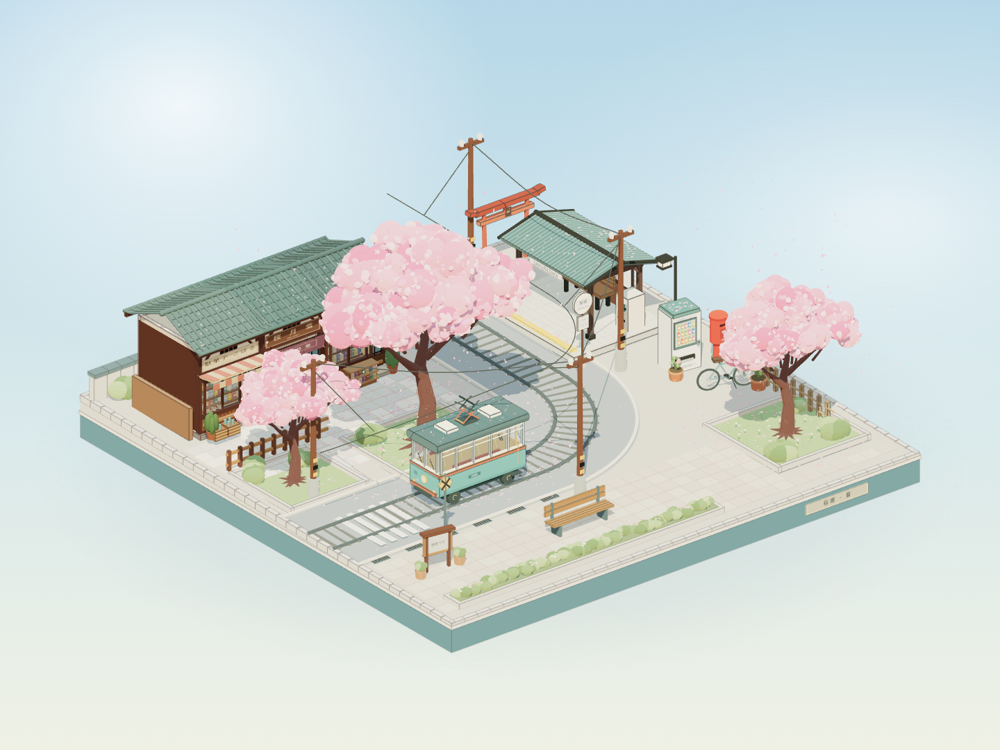

# 桜坂 · 春日微缩景观

用一段提示词生成一个可以拖拽旋转的 3D 场景 —— 春日晴天的日式樱花坡道街角，一列复古路面电车缓缓驶过。

<iframe src="/sakura/" width="100%" height="620" style="border:0;border-radius:12px;display:block;margin:1.5rem 0;" allowfullscreen loading="lazy"></iframe>

**可以拖拽旋转、滚轮缩放。** 场景是完全用 three.js 程序化搭出来的，不是渲染图 —— 每一片飘落的樱花、电车经过时车窗里流动的倒影，都是实时算的。



## 提示词里藏着的技术约束

这次没有从零想方案，而是先写了一段描述性很强的提示词，让 AI 照着做。回头看，提示词里有几句话直接决定了技术选型：

**"不准使用 blender"** —— 这一句排除了手工建模这条路。blender 建模要么手搓要么脚本，产出的是资产文件；禁掉它，剩下能走的就是**用代码把场景搭出来**。

**"第三视角观察整个场景，整体像一个可以自由拖拽、旋转、缩放观看的微缩三维模型"** —— 这句话拆开就是三个实现要求：

| 提示词里的说法 | 对应的实现 |
|--------------|-----------|
| 微缩三维模型 | `OrthographicCamera`（正交相机）—— 透视相机会近大远小，正交相机才是模型感 |
| 自由拖拽、旋转、缩放 | `OrbitControls` |
| 第三视角观察整个场景 | 固定俯角 + 限制极角，避免转到场景底部 |

**"三渲二，轮廓明确"** —— three.js 里对应 `MeshToonMaterial` 配一张 `gradientMap`（色阶贴图），把连续光照压成几级色带，这就是三渲二的基本做法。色带贴图是程序生成的一张小图，色调断点数量直接决定"渲染"感有多强。

**"淡粉色的花瓣如雪般持续飘落"** —— 粒子系统。

## 几个不显眼但花了功夫的地方

**电车车窗里的倒影是真的。** 最初想用一张环境贴图糊上去，但那样电车动的时候倒影不会动 —— 一眼就假。最后用的是 `CubeCamera`：把当前场景实时渲染成六面 cubemap，贴到车窗的 `envMap` 上，强度调低、加上 `clearcoat`。所以电车驶过时，车窗里映着的樱花和蓝天是真的在动。

**招牌和站牌上的字是代码画的。** `CanvasTexture` 新建一块画布，用 Canvas 2D API 写字、画底色，再贴到模型上。这样整个场景不依赖任何外部图片资源，也就意味着**整个 HTML 可以塞进一个文件里**。

**静态几何全合并了。** 场景里有大量静态小物件（砖块、栏杆、窗格、盆栽）。用 `mergeGeometries` 把材质相同的合并成单个 mesh，draw call 从几百降到几十。合并时按材质的完整参数做 key —— 颜色、粗糙度、透明度、阴影开关、renderOrder 都要一致才能合，所以代码里得逐项比对。

**阴影不是每帧重算。** `renderer.shadowMap.autoUpdate = false`，改成每 0.34 秒手动 `needsUpdate = true` 一次。场景是静态的，只有电车和花瓣在动，阴影频率降到 3 fps 完全看不出来，帧率却实打实省下来了。

**招牌用了衬线字体。** `"Yu Mincho", "Noto Serif JP", "Microsoft Yahei", serif` —— 日式老铺的招牌要竖排的明朝体气质，配上等距视角才不违和。

## 怎么变成一个文件

源码按模块拆开：主场景、电车、站台、老铺、反射、几何合并，加起来一千多行。打包用 esbuild，输出 IIFE 格式：

```javascript
const result = await build({
  entryPoints: ['src/main.js'],
  bundle: true, write: false, format: 'iife',
  target: 'es2020', minify: true, legalComments: 'eof'
});
```

关键的一行是后面这个替换：

```javascript
const script = result.outputFiles[0].text.replaceAll('</script', '<\\/script');
```

three.js 里到处是字符串模板，`</script>` 出现在代码里会让 HTML 提前结束脚本块 —— 这是把 JS 内联进 HTML 时最经典的一个坑。转义之后再拼进模板：

```javascript
const html = `<!DOCTYPE html>
<html lang="zh-CN"><head>...<title>桜坂 · 春日微缩景观</title></head>
<body><script>${script}</script></body></html>`;
```

最终产物是一个 613 KB 的 HTML，**不请求任何外部资源** —— three.js 整个内联在里面。扔到任何静态托管上都能直接跑，连构建产物都不用部署。

这也意味着它可以直接塞进博客的 `public/` 目录，变成一个独立页面，然后用 iframe 嵌到文章里 —— 就是上面那个可以拖的框。

## 一点感想

这个场景里没有一个人。

提示词里专门写了"不要人物，但场景内容要充实"，因为空荡荡的街角会显得潦草，但加满人又会变成另一回事 —— 那种拥挤的日常感不是这个场景想要的。所以用别的东西填：橱窗里的和果子陈列、候车亭的时刻表、电车车厢里整齐的吊环。

最后剩下的就只是一棵树、一列电车、和一场下不完的樱花雨。

安静、治愈、带一点青春和时光流动的温柔感。挺像日本动画里那种会被定格住的场景。
