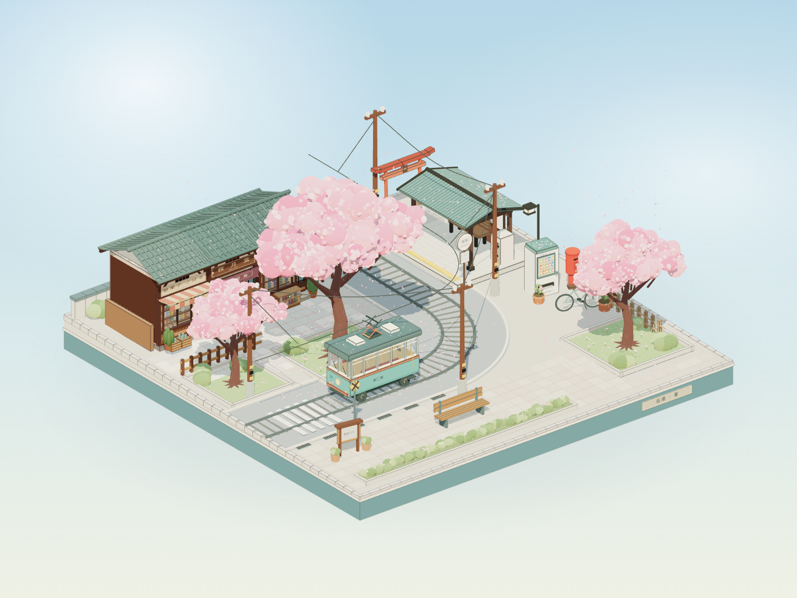

# 桜坂 · 春日微缩景观

用 GPT 6 astra 生成的樱花坂。

<iframe src="/sakura/" width="100%" height="620" style="border:0;border-radius:12px;display:block;margin:1.5rem 0;" allowfullscreen loading="lazy"></iframe>

**可以拖拽旋转、滚轮缩放。**

## 提示词

```text
请制作一个「春季晴天 × 满开樱花 × 复古路面电车」的日式樱花坡道街角微缩场景，不准使用blender，以第三视角观察整个场景，整体像一个可以自由拖拽、旋转、缩放观看的微缩三维模型 / 小型景观，没有任何UI界面元素。地面为一个完整的正方形底座，所有元素都搭建在这个底座上，构图紧凑、层次清晰，整体呈现出小巧、精致、可收藏的模型感。画面风格为三渲二，强调浓厚的日式二次元动画氛围，材质表现干净，轮廓明确，色彩柔和明亮，以粉白樱花色、清澈蓝天与温暖阳光为主调。
场景主体是一处春季晴朗午后的日式樱花坡道街角，正值满开的樱花树是底座的视觉中心，淡粉色的花瓣如雪般持续飘落，铺满缓坡路面、屋顶、站台与贩卖机。街道沿缓坡自然转折，铺设着路面电车轨道与架空电线，一辆复古涂装的单节日式路面电车会沿着轨道缓缓驶过街角，车窗干净明亮、倒映着流动的樱花与蓝天。街道一侧是一座无人值守的复古木制电车站台：老式候车亭、木质长椅、站牌、时刻表与自动售票机；另一侧是几间昭和风的日式老铺——杂货铺、和果子店、旧书店，挂着暖帘与木质招牌，门前有自动贩卖机、红色邮筒、自行车、木栅栏与盆栽。小巷入口处隐约露出鸟居与石灯笼一角。天气晴朗，蓝天白云，阳光透过樱花树洒下缓缓移动的斑驳光斑。不要人物，但场景内容要充实：老铺的玻璃橱窗内可见和果子陈列、零食货架与旧书堆，车站候车亭内有站牌与时刻表细节，电车车厢内座位与吊环整齐可见，让整个街角显得真实、有生活气息，却又空无一人，只有樱花与电车在动。
美术风格重点强调：高精细建模、三渲二卡通渲染、清晰的轮廓线、细腻但简洁的材质层次、春日阳光的柔和通透感、樱花粉与蓝天暖阳的清新配色、浓厚的二次元日常场景感。整体气质应偏向安静、治愈、带一点青春与时光流动的温柔感，像一幕被定格下来的日本动画樱花街角场景模型。不用任何skill
```

## 实例



<div style="text-align:center;margin-top:0.5rem;">
  <a href="/sakura/" target="_blank">在新标签页打开 3D 场景 →</a>
</div>
